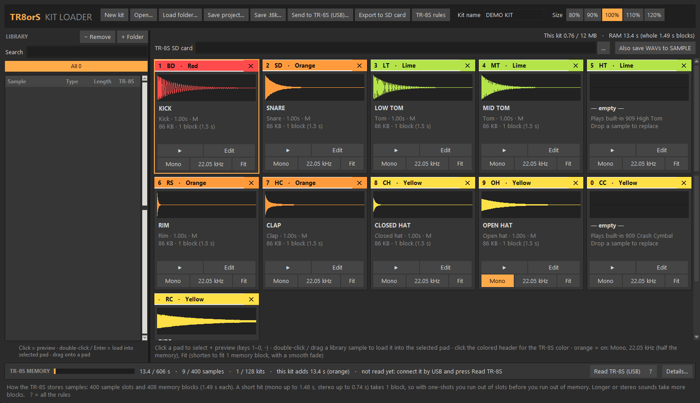
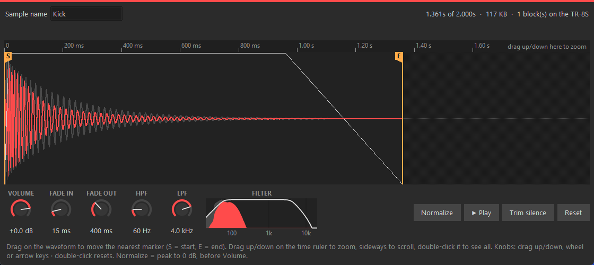

# TR8orS Kit Loader

A free, open-source Windows app for building sample kits for the **Roland TR-8S**.

Drop in your own WAV, AIFF or FLAC one-shots and trim, fade, filter and shrink them. Then send the kit straight to the
TR-8S over USB, or save it as a `.t8k` kit file for the SD card. The app always knows how much of the TR-8S sample
memory you are using, so kits never fail to load because the memory is full.



> TR8orS Kit Loader is an independent project. It is not made, endorsed or supported by Roland Corporation.
> "Roland", "TR-8S" and "AIRA" are trademarks of Roland Corporation, used here only to describe what the app works with.

---

## Contents

- [What it does](#what-it-does)
- [Install](#install)
- [Quick start](#quick-start)
- [The main window](#the-main-window)
- [The sample editor](#the-sample-editor)
- [The sample library](#the-sample-library)
- [Getting kits onto the TR-8S](#getting-kits-onto-the-tr-8s)
- [TR-8S memory: the rules that matter](#tr-8s-memory-the-rules-that-matter)
- [Managing the TR-8S memory](#managing-the-tr-8s-memory)
- [Projects and files](#projects-and-files)
- [Keyboard and mouse](#keyboard-and-mouse)
- [Troubleshooting](#troubleshooting)
- [Building from source](#building-from-source)
- [How this was made](#how-this-was-made)
- [License](#license)

---

## What it does

- **11 pads**, one for each TR-8S instrument (BD, SD, LT, MT, HT, RS, HC, CH, OH, CC, RC), each in its TR-8S color.
  Pads you leave empty play the built-in 909 sound for that instrument.
- **Drag and drop** samples or folders onto the pads, or load a whole folder at once. The files fill the pads in
  alphabetical order.
- **A sample editor** in the style of Ableton's Simpler, with:
  - draggable start and end markers;
  - fade-in and fade-out;
  - high-pass and low-pass filters;
  - volume from −∞ to +6 dB;
  - a Normalize toggle;
  - Trim silence.
- **Memory savers on every pad:**
  - **Mono** halves the size of a stereo sample;
  - **22.05 kHz** halves it again;
  - **Fit** shortens a sample to one memory block with a smooth fade.
- **Click-free.** Every cut ends with a short fade, so there are no clicks when a sound stops.
- **Your files are never changed.** Samples are only ever read. All editing is applied to the copy that goes into the
  kit.
- **Send to the TR-8S over USB.** The app:
  - uploads only the samples that aren't on the TR-8S yet (samples already on it are re-used, not duplicated);
  - writes the kit into the slot you choose;
  - keeps the kit after a power cycle.
- **Save `.t8k` kit files** for the TR-8S SD card. You can also open and edit existing `.t8k` files, including kits
  exported from a TR-8S.
- **Memory tracking.** After one USB read, the memory bar shows the TR-8S's real memory: samples, kits and free blocks.
  It also shows how much the current kit would add.
- **A sample library.** Add your sample folders once, then browse and search them, filtered by type (kick, snare, hat…).
  Samples that are already on the TR-8S are marked.
- **Clean-up tools** for the TR-8S:
  - list every user sample and which kits use it;
  - delete selected samples, with a warning that names each affected kit;
  - delete all unused samples;
  - optimize (defragment) the memory.
- **Resizable.** The pads re-flow into more rows when the window is narrow. Size presets go from 80 % to 120 %.

## Install

### The ready-made app (easiest)

1. Download `TR8orS-Kit-Loader.exe` from the [Releases](../../releases) page.
2. Double-click it. Nothing needs to be installed. Windows SmartScreen may warn about an unknown publisher the first time;
   click **More info → Run anyway**.

### For USB: install the Roland driver

USB features need Roland's **TR-8S driver** for Windows (download it from Roland's TR-8S support page). After installing
it:

- connect the TR-8S with a USB cable and switch it on (normal mode, **not** Storage mode);
- leave **UTILITY → MIDI → Device ID** at **17** (the factory setting);
- close any other program that uses the TR-8S over MIDI (a DAW, for example) while the app talks to it.

Without the driver you can still do everything except USB: build kits, edit samples and save `.t8k` files for the SD
card.

## Quick start

### Kit straight to the TR-8S (recommended)

1. Connect the TR-8S by USB and press **Read TR-8S (USB)** at the bottom of the window. The memory bar now shows the
   real memory of your TR-8S.
2. Drag samples onto the pads, or click **Load folder…**.
3. Look at the orange part of the memory bar: that is what this kit adds. If it is too much, press **Mono**, **22.05 kHz**
   or **Fit** on the long pads.
4. Type a **Kit name**, click **Send to TR-8S (USB)…**, and pick the kit slot to write to.

It takes about 9 seconds per memory block to upload new samples. Samples that are already on the TR-8S are re-used
and take no time.

### Kit to the SD card

1. Press **Read TR-8S (USB)** once, ever. The app copies one kit's settings (effects, tune, decay…) from your TR-8S, and
   brand-new kit files start from those settings. (You can skip this if you only edit `.t8k` files exported from your
   TR-8S.)
2. Build the kit as above.
3. Set the **TR-8S SD card** folder (the card's drive, or its `ROLAND\TR-8S` folder) and click **Export to SD card**.
   You can also save a `.t8k` anywhere with **Save .t8k…**.
4. On the TR-8S: **UTILITY → Import → Kit → EXPORT**, pick the kit, pick the destination slot, then **OK**.

## The main window


### Toolbar (the dark box at the top)

| Button | What it does |
|---|---|
| **New kit** | Empties all pads. |
| **Open…** | Opens a project (`.tr8proj`) or a TR-8S kit (`.t8k`). The samples of an opened kit appear on the pads and can be edited. |
| **Load folder…** | Loads the samples in a folder onto the free pads, in alphabetical order. |
| **Save project…** | Saves the kit as a project: pads, settings and links to your sample files. You choose where. |
| **Save .t8k…** | Writes a TR-8S kit file anywhere you like. |
| **Send to TR-8S (USB)…** | Uploads the kit to a kit slot on the TR-8S. |
| **Export to SD card** | Writes the kit straight into `ROLAND\TR-8S\EXPORT\KIT` on the SD card. |
| **TR-8S rules** | All the memory and format rules, in plain language. |
| **Kit name** | Up to 16 characters, shown on the TR-8S display. |
| **Size** | 80–120 %: makes all text, pads and lists smaller or larger. |

The toolbar wraps onto a second line when the window is narrow.

### Pads

Each pad shows:

- its key (1–0, -), its instrument and its TR-8S color. Click the colored header to change the color; the color is
  saved in the kit;
- **✕**, which empties the pad (it then plays the built-in 909 sound);
- the waveform, which you click to select the pad and hear it;
- the sample name and type, and its length, size and memory blocks;
- a line about the TR-8S when the same sample is already on it;
- **▶** (play), **Edit** (opens the editor), and the three toggles **Mono**, **22.05 kHz** and **Fit**. A toggle is
  orange when it is on.

### Memory bar

At the bottom: *used / 606 s*, *samples / 400*, *kits / 128*, and how much the current kit adds (in orange).

- **Read TR-8S (USB)** reads the real state of your TR-8S.
- **?** explains the bar.
- **Details…** opens the TR-8S memory window ([Managing the TR-8S memory](#managing-the-tr-8s-memory)).

## The sample editor

Click **Edit** on a pad.



- **The waveform shows the result.** The untouched sample is drawn in gray, and in front of it, in the pad's color, is
  exactly what goes to the TR-8S: fades, filters, Volume and Normalize included. You see a fade-out make the tail
  shrink, or a high-pass filter take the low end out of a kick.
- **S / E markers.** Drag on the waveform to move the nearest marker (S = start, E = end). The darkened parts are cut
  off.
- **Zoom (like Simpler).** Point at the time ruler above the waveform: the cursor becomes a magnifying glass. Click a
  spot and drag **down to zoom in** on it, **up to zoom out**, and sideways to scroll. Double-click the ruler to see
  the whole sample again. Use it to place the markers exactly.
- **Knobs:** drag up or down, use the mouse wheel or the arrow keys, or double-click to reset. The name of the knob the
  arrow keys control turns orange.
  - **Volume:** −∞ to +6 dB, default 0 dB.
  - **Fade in / Fade out:** smooth S-curve fades, also shown as the white line.
  - **HPF / LPF:** high-pass and low-pass filters.
- **Filter graph** (next to the knobs): the white line is the HPF/LPF response. Gray is the sample's own frequency
  spectrum, and the colored part is what is left after the filters.
- **Normalize:** when on, the sample is raised to full level (peak 0 dB) before the volume knob.
- **Trim silence:** moves the markers to where the sound starts and ends.
- **Play** previews exactly what will go into the kit. **Reset** undoes all edits.
- The top line shows the new length, the size and how many TR-8S memory blocks the sample takes.
- If this sample is already on your TR-8S with other settings, the editor says so. **Use TR-8S settings** switches to
  those settings, so the sample on the TR-8S can be re-used instead of uploaded again.

Every edit is applied in the same way to the `.t8k`, the USB upload and the optional WAV copies. Your original file
never changes.

## The sample library

The panel on the left.

- **+ Folder** adds a sample folder (it is scanned, including sub-folders). **− Remove** removes the selected folder from
  the library; it never deletes files.
- **Search** filters by name. The **type chips** (Kick, Snare, Closed hat…) filter by type and show how many samples of
  each type you have. Types come from file and folder names.
- **Click** a sample to preview it. **Double-click** it, or press **Enter**, to load it into the selected pad. You can
  also drag it onto any pad.
- The **TR-8S** column and the **ON TR-8S** chip mark samples that are already on your TR-8S, after a USB read.
- When you load a sample that is already on the TR-8S, the app uses the same settings automatically so the copy on the
  TR-8S can be re-used. If a *similar* sample is on it (the same file with other settings, for example), the app warns
  you.

## Getting kits onto the TR-8S

### Over USB (best)

**Send to TR-8S (USB)…** asks for a kit slot (1–128) and shows what is in each slot. Then it:

1. checks the memory and refuses kits that do not fit;
2. uploads only the samples that are not on the TR-8S yet;
3. writes the kit into the slot and checks that it arrived.

A new kit keeps the kit settings (effects, tune, decay…) of the slot it goes into. A kit you opened from a `.t8k` keeps
its own.

### Over the SD card

- **Import always duplicates.** Every time you import a kit, its samples are added to the TR-8S again, even if they
  are already there. Importing the same kit twice uses twice the memory. USB doesn't have this problem.
- Format the card in the TR-8S (**UTILITY → SD CARD FORMAT**). Kits go in `ROLAND\TR-8S\EXPORT\KIT`.
- **Also save WAVs to SAMPLE** (off by default) also writes the processed samples to `ROLAND\TR-8S\SAMPLE`, for the
  TR-8S's own sample import.
- Don't import a kit with no samples. The TR-8S rejects it (Read Error), and the app won't create one.

## TR-8S memory: the rules that matter

The TR-8S has **400 sample slots** and **408 memory blocks**. Each block is 128 KB, which is 1.49 s of mono audio at
44.1 kHz; together they hold 606 s.

- **Every sample uses whole blocks.** A 0.1 s hi-hat still uses one full block (1.49 s). One-shots fill the 400 slots
  long before they fill the memory.
- **Mono up to 1.48 s or stereo up to 0.74 s = 1 block.** Longer or stereo sounds take more blocks.
- **Mono** halves a stereo sample. **22.05 kHz** halves it again (it sounds a little duller). **Fit** shortens a sample
  to exactly one block, with a smooth fade at the end.
- **The same sample with other settings is another copy.** Mono, 22.05 kHz, trims, fades, filters and volume all
  change the audio, so they make a new sample on the TR-8S.
- **Empty pads cost nothing.** They play the built-in 909 sound.
- Deleting samples can leave gaps. **Optimize** packs the memory together again.

All of this is also inside the app, under **TR-8S rules**.

## Managing the TR-8S memory

**Details…** (next to the memory bar) opens the TR-8S memory window. It shows the following, after a USB read:

- **Memory:** used and free blocks, the slot count, and whether the memory is fragmented.
- **Kits using your samples:** each kit, with its number of samples and how much memory they use.
- **Samples on the TR-8S:** every user sample, with its size and the kits that use it.
  - Select one or more samples and click **Delete selected…** (or press Delete). If any kit uses a selected sample, the
    warning lists each kit by number and name, and the pads that change. For example:
    `Kit 3 "MY KIT": BD → 909 Bass Drum`. Those pads switch to the built-in 909 sound.
- **Delete unused samples…** deletes the samples that no kit uses.
- **Optimize…** defragments the memory. It says "Nothing to optimize" when there are no gaps.

While the app works on the TR-8S, the TR-8S display shows a "TR8orS" message and its panel is locked. Don't switch it off
during an upload, delete or optimize.

## Projects and files

| File | What it is |
|---|---|
| `*.tr8proj` | A project: kit name, colors, every pad's sample path and settings. It links to your samples and does not copy them. |
| `*.t8k` | A TR-8S kit file, the same format the TR-8S exports. |
| `%APPDATA%\TR8orS-Kit-Loader\` | The app's own data: settings (window size, zoom, SD folder, library folders), the last TR-8S read, which library files were uploaded, and the kit settings copied from your TR-8S. Delete this folder to reset the app. |
| `Documents\TR8orS-Kit-Loader\` | Default folder for projects and kits. |

Nothing is sent anywhere except to your TR-8S over USB. The app never connects to the internet.

## Keyboard and mouse

| Key / action | What it does |
|---|---|
| **1 2 3 4 5 6 7 8 9 0 -** | Play the 11 pads (BD … RC) |
| Click a pad | Select it and preview it |
| Drag files or a folder onto a pad | Load them: the first goes on that pad, the rest on the pads after it |
| Drag files onto an empty part of the window | Load them onto the free pads |
| Mouse wheel over the pads | Scroll the pads |
| Library: click / double-click / Enter | Preview / load into the selected pad |
| Editor knobs: drag, wheel, arrows, double-click | Change / fine-tune / reset |
| TR-8S memory window: Delete | Delete the selected samples |

## Troubleshooting

**"No answer from a TR-8S over USB"**

- Is the Roland TR-8S driver installed? Is the cable a data cable?
- The TR-8S must be in normal mode, not Storage mode.
- Set **UTILITY → MIDI → Device ID** to 17.
- Close any other program that uses the TR-8S (a DAW, Roland's own tools).

**"A kit file needs a starting kit"**
: Press **Read TR-8S (USB)** once with your TR-8S connected, or open a `.t8k` exported from your TR-8S first. The app
  ships with no kit data of its own.

**The TR-8S shows Read Error when importing**
: The kit has no samples, or the card is damaged. Format the card in the TR-8S and export again.

**The memory bar says "not read yet"**
: Press **Read TR-8S (USB)**. Until then the app counts only the current kit.

**Memory full**
: Use **Mono**, **22.05 kHz** or **Fit** on long or stereo pads, or delete unused samples under **Details…**.

## Building from source

You need Windows and Python 3.12 or later.

```bash
pip install -r requirements.txt
```

```bash
python app.py
```

To build the one-file `.exe` (written to `dist\`):

```bash
build.bat
```

The self-test needs no TR-8S. Pass it a `.t8k` exported from a TR-8S:

```bash
python selftest.py path\to\exported-kit.t8k
```

### Code layout

| File | What it holds |
|---|---|
| `app.py` | The window, pads, sample editor, library browser and TR-8S memory window |
| `t8k.py` | Reading and writing the `.t8k` kit format |
| `tr8s_usb.py` | Talking to the TR-8S over USB MIDI (SysEx) |
| `library.py` | Sample library scan, type detection and memory accounting |
| `selftest.py` | End-to-end tests without hardware |
| `docs/TECHNICAL.md` | The file format, the USB protocol and the hardware findings |

## How this was made

TR8orS Kit Loader was vibe-coded with [Claude](https://claude.com/claude-code). The design, testing on real hardware
and every decision were mine; Claude wrote most of the code.

## License

MIT. See [LICENSE](LICENSE). Third-party components and their licenses are listed in
[THIRD_PARTY_NOTICES.md](THIRD_PARTY_NOTICES.md).
